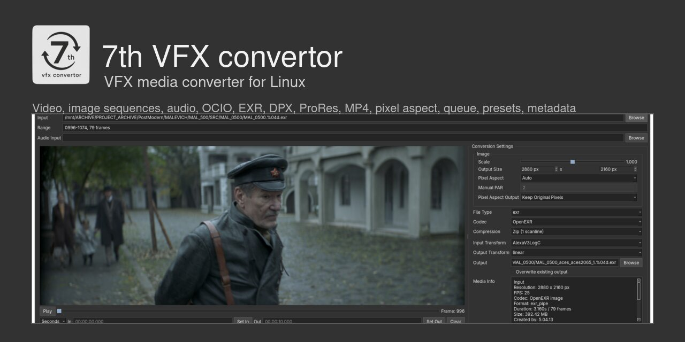
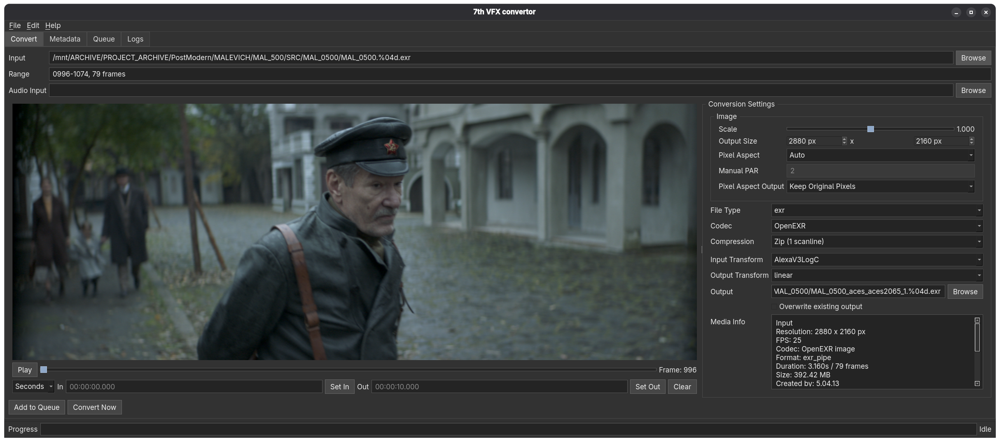

<p align="center">
  
</p>

<p align="center">
  
  
  
</p>

# 7th VFX convertor

Десктопний конвертор VFX-відео, послідовностей кадрів, зображень та аудіо з **плеєром на Rust**, інтерфейсом Python/PySide6 (Qt 6) і конвертацією через FFmpeg.

[English](README.md) · [Встановлення та запуск](#встановлення-та-запуск) · [Плеєр на Rust](#плеєр-на-rust) · [Формати](#формати) · [Чистий комплект](#чистий-комплект)



## Можливості

- Відтворення відео й послідовностей кадрів, перемотування, покадрові переходи та маркери In/Out через Rust-плеєр.
- Автоматичне визначення sequences, оригінальна нумерація кадрів і розбиття на діапазони за наявності пропусків.
- Конвертація всього джерела або вибраного діапазону, черга завдань, збереження пресетів і перетягування файлів.
- Вибірка кадрів: перший кадр та кожен N-й кадр зі збереженням глобальної нумерації джерела.
- Розмір результату, масштаб, автоматичний/ручний pixel aspect і перерахунок у квадратні пікселі.
- Керування кольором через OCIO: вбудований Nuke-style config або власна конфігурація, зокрема ACES.
- Вбудований або зовнішній звук, окремий експорт аудіо та додавання звуку в MP4 без перекодування відео.
- Інформація про медіа, метадані й відкриття теки результату після конвертації.

## Плеєр на Rust

**Керування відтворенням, вибір кадрів, таймінг і перемотування працюють в окремому ядрі на Rust.** FFmpeg декодує медіа, а Python/Qt показує кадри та відповідає за інтерфейс і звук. Конвертор та експорт залишаються на Python + FFmpeg.

Плеєр підтримує часові мітки відео, включно з VFR, послідовності з оригінальною нумерацією, покадрові переходи й колірні перетворення на паузі та під час відтворення. Перетягування таймлайна використовує обмежений кеш preview; відпускання повзунка встановлює точну кінцеву позицію та відновлює стан відтворення/паузи.

Для показу використовується 8-бітний RGBA-буфер під розмір області preview. Це не знижує точність експорту й не змінює вихідне медіа. GPU-декодування та перегляд окремих каналів ще не реалізовані; переходи назад на довгих відео або до кадрів поза кешем можуть потребувати часу.

Для кожної ОС/процесора потрібна нативна збірка плеєра. Встановіть Rust/Cargo через [rustup](https://rustup.rs/) та засоби компонування своєї ОС: MSVC Build Tools для Windows або Apple Command Line Tools для macOS. Toolchain зафіксований у `rust/player/rust-toolchain.toml`.

Запускайте конвертор через launcher своєї платформи: він готує локальне середовище, збирає Rust-плеєр за наявності Cargo та відкриває програму. Актуальний сумісний бінарник використовується повторно; вводити Python-команди вручну не потрібно.

```bash
# Linux / macOS
./7th-vfx-convertor.sh
```

```powershell
# Windows
.\7th-vfx-convertor.bat
```

Виконуваний файл встановлюється в `seventh_convert/bin/`. Для запуску готової сумісної збірки Cargo не потрібен. Якщо немає ні сумісного бінарника, ні Cargo, launcher повідомляє про використання Qt preview. Помилка збірки Cargo зупиняє запуск із діагностикою.

## Встановлення та запуск

Потрібні **Python 3.11+**, **FFmpeg і ffprobe** у `PATH`. `uv` необов'язковий: launchers створюють локальну `.venv` через `uv` або стандартні Python `venv`/`pip`. Не переносіть віртуальне середовище між комп'ютерами.

Один раз завантажте джерела:

```bash
git clone https://github.com/Slavich86/7th-convert.git
cd 7th-convert
```

### Linux

Встановіть FFmpeg через пакетний менеджер свого дистрибутива й запустіть:

```bash
chmod +x 7th-vfx-convertor.sh
./7th-vfx-convertor.sh
```

Додатковий `.desktop` launcher має лежати поруч із `.sh`.

### Windows

Встановіть Python 3.11+ і запустіть:

```powershell
.\7th-vfx-convertor.bat
```

Якщо FFmpeg відсутній, launcher запропонує включений `install-ffmpeg.bat`, який використовує `winget`. Тримайте `install-ffmpeg.ps1` поруч із ним. Після встановлення перевідкрийте термінал, щоб отримати оновлений `PATH`.

### macOS

За наявності [Homebrew](https://docs.brew.sh/Installation):

```bash
brew install python@3.13 uv ffmpeg
chmod +x 7th-vfx-convertor.sh
./7th-vfx-convertor.sh
```

Для запуску через Finder також можна надати `7th-vfx-convertor.command` право виконання й двічі натиснути його: він запускає той самий `.sh` і має лежати поруч із ним. Launcher враховує шляхи Homebrew для Apple Silicon та Intel. Для нативного Rust-плеєра встановіть Cargo й Apple Command Line Tools (`xcode-select --install`). Підписаного/notarized `.app` у комплекті немає.

**Перевірка платформ:** відтворення та інтеграційні перевірки виконувалися на Linux. Launchers для Windows і macOS включені, проте встановлення та playback на справжніх Windows/macOS ще потребують перевірки.

Launchers знаходять файли відносно власної теки, включно зі шляхами з пробілами. На Windows також можна двічі натиснути `7th-vfx-convertor.bat`.

`Help → Check for Updates` потребує Git-клону. ZIP-архіви та перенесений вміст `publish/` не мають `.git` і не можуть оновлюватися цим способом.

## Формати

| Медіа | Вхід | Вихід |
|---|---|---|
| Відео | MOV, MP4, MKV, TS, MXF, M4V, AVI, WEBM | MOV (ProRes), MP4 (H.264 / H.265, включно з NVENC) |
| Зображення / sequences | EXR, DPX, PNG, JPG/JPEG, TGA/TARGA, TIF/TIFF, GIF | EXR, DPX, PNG, JPG, TARGA, GIF |
| Аудіо | WAV, MP3, AAC, M4A, FLAC, OGG | WAV, MP3, AAC |

Доступність кодеків залежить від збірки FFmpeg та обладнання. EXR за замовчуванням використовує half float із вибором компресії; PNG підтримує RGB/RGBA у 8 або 16 бітах. Якість JPG і палітра/дизеринг GIF налаштовуються.

## Колір, геометрія та звук

Вхідний і вихідний колірні трансформи задаються окремо. `Color Management: None` не застосовує OCIO LUT, колірні перетворення FFmpeg або примусові вихідні color metadata. Для керування кольором виберіть вбудований `Nuke Default OCIO` або власний `config.ocio`, зокрема ACES.

Список **Display** над плеєром пропонує **sRGB Monitor** і **Rec.709 Monitor**. Input Transform описує джерело; плеєр перетворює його у вибраний простір монітора на паузі, під час програвання й перемотування. Output Transform впливає лише на експорт. Вибір монітора зберігається окремо й не змінює експортовані файли. При Color Management = None список Display вимкнений і перетворення для монітора не застосовується. Власна OCIO-конфігурація повинна містити відповідний простір sRGB/Rec.709; його відсутність показується як помилка плеєра.

Pixel aspect визначається автоматично, включно з EXR metadata, або задається вручну. `Keep Original Pixels` зберігає розмір растра; `Resize to Square Pixels` перераховує його для квадратних пікселів. Наприклад, джерело 2880 × 2160 із PAR 2.0 показується як 5760 × 2160.

Використовуйте вбудований звук або додайте зовнішній файл через `Audio Input`. Режим `Add Audio Without Re-encoding Video` копіює MP4 video stream і кодує/додає аудіо; зміна розміру, FPS і кольору в цьому режимі вимкнена.

Пресети локально зберігають налаштування конвертації, діапазону, геометрії, кольору та звуку. Перезапис результату потребує явного параметра overwrite; вихідне медіа не можна перезаписувати.

## Хоткеї

Працюють у зоні плеєра, preview placeholder, кнопці Play і таймлайні; введення в полях In/Out зберігається.

| Клавіша | Дія |
|---|---|
| Left / Right | Назад / уперед на один кадр |
| Down / Up | Назад / уперед на десять кадрів |
| I / O | Встановити маркер In / Out |

## Чистий комплект

Цей репозиторій містить готовий конвертор, перенесений із теки `publish/` робочого проєкту. Клонуйте його або розпакуйте завантажений ZIP і запустіть launcher своєї платформи з цієї теки.

До комплекту входять робочий Python-код, пресети, OCIO/LUT, іконки, launchers, FFmpeg installer, користувацька документація, мінімальні Rust-джерела та готовий release-плеєр для **Linux**. Тести, скрипти розробки, benchmarks, старі логи, кеші й віртуальні середовища виключені. Детальне трасування плеєра за замовчуванням вимкнене.

Залежності встановлюються в нову локальну `.venv`; FFmpeg/ffprobe потрібні окремо. Для Windows і macOS потрібна власна нативна збірка плеєра із включених Rust-джерел, як описано вище. Самої вкладеної теки `publish/` у цьому репозиторії немає: її вміст розміщено безпосередньо в корені.

## Підтримати розробку

PayPal: `sl.oxuta@gmail.com`.
